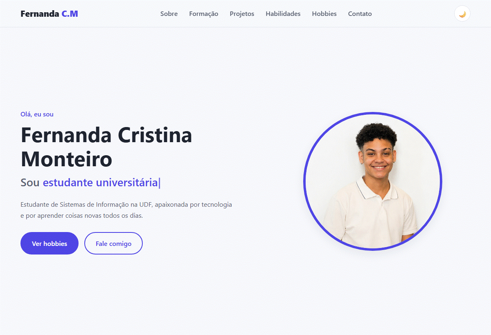

# Portfólio pessoal — Fernanda Cristina Monteiro

Projeto final da disciplina de **Desenvolvimento Front-end para Web**. O trabalho consiste em um portfólio pessoal que reúne minha apresentação, formação acadêmica, projetos, habilidades e interesses em uma página responsiva.

**[Acesse o site publicado](https://fernanda01cm.github.io/Projeto-final-Eliel/)**

## Demonstração

Amostra da página inicial nos temas claro e escuro:



## Objetivo do trabalho

Aplicar os conhecimentos de HTML, CSS e JavaScript na construção de um site pessoal completo, com organização do conteúdo, adaptação a diferentes tamanhos de tela e recursos de interação. O projeto também exercita o versionamento com Git e a publicação de um site estático no GitHub Pages.

## Conteúdo da página

- **Início:** apresentação com foto, texto animado e atalhos para hobbies e contato.
- **Sobre mim:** trajetória pessoal e informações de contato.
- **Formação e experiência:** linha do tempo com graduação, ensino médio e cursos complementares.
- **Projetos acadêmicos:** acesso aos repositórios no GitHub.
- **Habilidades:** barras animadas de HTML, CSS, JavaScript e trabalho em equipe.
- **Hobbies e interesses:** jiu-jitsu, música, leitura e viagens.
- **Contato:** links para e-mail, GitHub e LinkedIn, além de um formulário.

## Funcionalidades

- Layout responsivo com CSS Grid e Flexbox.
- Menu recolhível em telas menores.
- Alternância entre tema claro e escuro, com preferência salva no navegador.
- Efeito de digitação na apresentação.
- Animações de entrada das seções e preenchimento das barras de habilidades durante a rolagem.
- Validação de campos obrigatórios e do formato do e-mail no formulário.
- Ano do rodapé atualizado automaticamente.
- Textos alternativos nas imagens e indicação de foco para navegação por teclado.

**Como funciona o contato:** o formulário abre o aplicativo de e-mail do visitante com o assunto e a mensagem preenchidos para `fernanda.dev.si@gmail.com`. O envio deve ser concluído nesse aplicativo. Não há backend ou serviço de envio de mensagens integrado.

## Tecnologias utilizadas

| Tecnologia | Uso no projeto |
| --- | --- |
| HTML5 | Estrutura e conteúdo da página |
| CSS3 | Estilos, temas, responsividade e animações |
| JavaScript | Menu, tema, validação e interações |
| LocalStorage | Armazenamento da preferência de tema |
| IntersectionObserver | Animações conforme as seções entram na tela |
| Git e GitHub | Versionamento e hospedagem do código |
| GitHub Pages | Publicação do site |

O projeto usa HTML, CSS e JavaScript puros, sem frameworks ou dependências de instalação.

## Estrutura de arquivos

```text
Projeto-final-Eliel/
├── docs/
│   └── demonstracao.gif   # Amostra visual para este README
├── img/
│   ├── HERO.jpeg         # Foto da apresentação
│   └── jiu-jitsu.jpeg    # Imagem da seção de hobbies
├── index.html            # Conteúdo principal
├── style.css             # Estilos e responsividade
├── script.js             # Interações da página
├── LICENSE               # Licença do projeto
└── README.md             # Apresentação e documentação
```

## Como executar localmente

1. Clone o repositório:

   ```bash
   git clone https://github.com/fernanda01cm/Projeto-final-Eliel.git
   ```

2. Abra a pasta `Projeto-final-Eliel`.
3. Abra o arquivo `index.html` no navegador. Também é possível usar a extensão Live Server do VS Code para visualizar as alterações durante o desenvolvimento.

Não é necessário instalar pacotes ou executar um processo de build.

## Publicação

O site está configurado para publicação pelo **GitHub Pages**, a partir da branch `main` e da pasta raiz `/`. As atualizações enviadas para essa branch são usadas na publicação.

Endereço do portfólio: **https://fernanda01cm.github.io/Projeto-final-Eliel/**

## Autora

**Fernanda Cristina Monteiro** — estudante de Sistemas de Informação na UDF.

- [GitHub: fernanda01cm](https://github.com/fernanda01cm)
- [LinkedIn](https://www.linkedin.com/in/fernanda-cristina-monteiro-84194a433/)
- [E-mail](mailto:fernanda.dev.si@gmail.com)

## Licença

Consulte o arquivo [LICENSE](LICENSE) para os termos de uso deste projeto.
